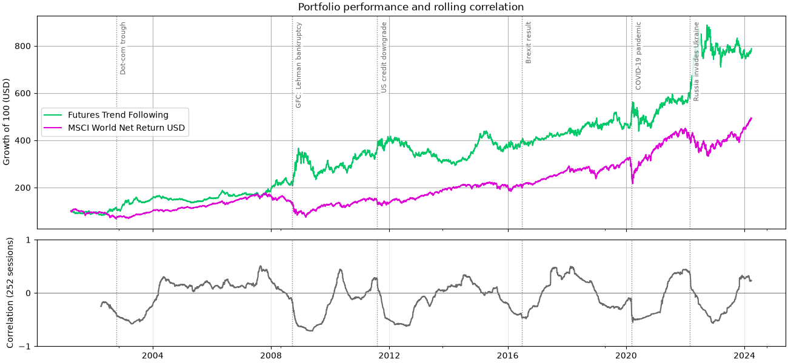
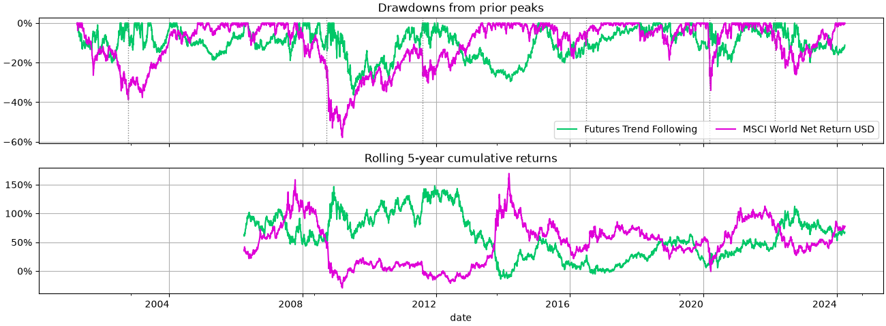
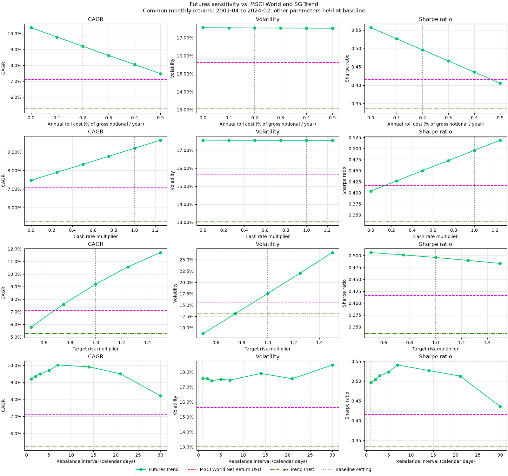
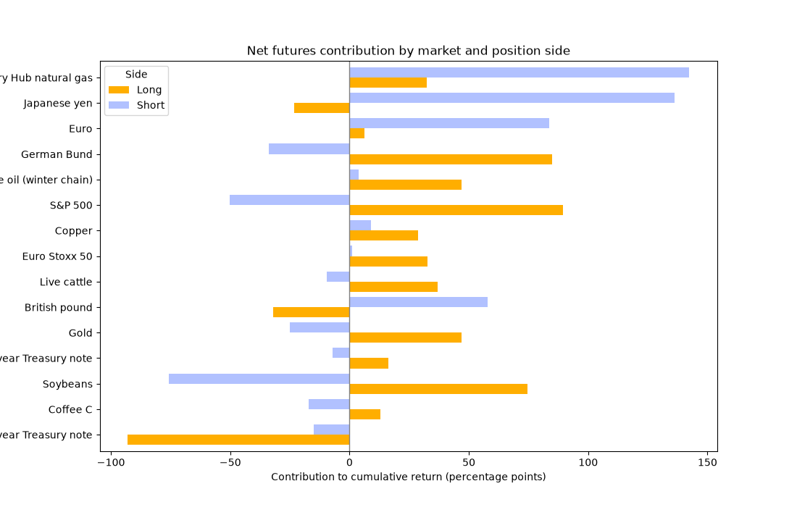

Il trend following è molto semplice: esposizione long per gli asset che hanno performato bene nel passato e short per quelli che hanno fatto <s>schifo</s> meno bene.

In un mercato ideale, il loro ruolo nell'asset allocation è ormai ampiamente documentato in accademia e altrettanto semplice: ulteriore diversificazione verso stocks e bonds e fonte di rendimento in regimimi di bassa crescita.

Quando però si introducono tutti gli attriti dei mercati finanziari... la questione si complica. In primis, l'investitore retail (a seconda del paese di residenza) ha spesso a disposizione pochi prodotti che replicano la strategia a costi relativamente alti e poca trasparenza sul sottostante.
Non esiste infatti una definizione di trend following biunivoca: ogni fondo ha la propria metodologia, la propria implementazione, il proprio universo investibile, la propria struttura di costi etc etc... di conseguenza è sempre stato difficile 1) trovare un benchmark unico e 2) capire esattamente che cosa stesse succedendo a position-level.

La curiosità tuttavia resta: come si traduce "compro chi va bene, shorto il contrario" sul mercato?

Per rispondermi, ho simulato una strategia liberamente inspirata dal libro "Following the Trend: Diversified Managed Futures Trading" di Clenow, implementando la stessa logica long/short su un universo di contratti futures ridotto e facendo le solite analisi del caso.

In particolare, non avendo <s>un terminale Bloomberg</s> accesso illimitato a tutte le serie unadjusted di futures, ho dovuto restringere l'analisi alle serie adjusted, dal 2000 al 2024, dei seguenti contratti futures. _(Per ogni contratto, si riportano il settore, l'underlying, l'unità di quotazione, la valuta e il point value, i.e. la variazione in valore del contratto a fronte di un movimento di un 1bp):_

| Contratto | Settore | Underlying | Unità di quotazione | Valuta | Valore per bp |
| --- | --- | --- | --- | --- | ---: |
| ES | Azioni | S&P 500 | Punti indice | USD | 50 |
| FESX | Azioni | Euro Stoxx 50 | Punti indice | EUR | 10 |
| ZT | Titoli di Stato | Treasury USA a 2 anni | % del nominale | USD | 2.000 |
| ZN | Titoli di Stato | Treasury USA a 10 anni | % del nominale | USD | 1.000 |
| FGBL | Titoli di Stato | Bund tedesco | % del nominale | EUR | 1.000 |
| 6E | Valute | Euro | USD per EUR | USD | 125.000 |
| 6J | Valute | Yen giapponese | USD per JPY | USD | 12.500.000 |
| 6B | Valute | Sterlina britannica | USD per GBP | USD | 62.500 |
| CL | Energia | Petrolio WTI (catena invernale) | USD/barile | USD | 1.000 |
| NG | Energia | Gas naturale Henry Hub | USD/MMBtu | USD | 10.000 |
| GC | Metalli | Oro | USD/oncia troy | USD | 100 |
| HG | Metalli | Rame | USD/libbra | USD | 25.000 |
| ZS | Agricoltura | Soia | Centesimi di USD/bushel | USD | 50 |
| KC | Agricoltura | Caffè C | Centesimi di USD/libbra | USD | 375 |
| LE | Agricoltura | Bovini vivi | Centesimi di USD/libbra | USD | 400 |

La strategia in sé combina due segnali diversi per costruire posizioni long e short: in primis, un filtro basato su medie mobile esponenziali definisce se lo strumento è in trend positivo o negativo. 

Successivamente, in caso di trend positivo, si entra in una posizione long se il prezzo raggiunge un massimo locale sulle 100 chiusure precedenti. Al contrario, in caso di trend negativo, si entra in una posizione short se il prezzo raggiunge o scende sotto un minimo locale. In assenza di segnali di ingresso o di uscita, si mantiene la posizione corrente _(si noti quindi che la strategia può rimanere non-investita)._ L'esposizione per ogni strumento è successivamente determinata dalla sua volatilità storica in relazione alla volatilità target del portafoglio.

In formule, sia $A_t$ il prezzo di chiusura <a href="" target="_blank">Panama-adjusted </a> al tempo $t$, $\mathrm{EMA}_{n,t}$ la sua media mobile esponenziale a $n$ sedute e $s_t$ la variabile binaria che definisce il trend.

$$
s_t = \begin{cases}
+1, & \mathrm{EMA}_{50,t} > \mathrm{EMA}_{100,t}, \\
-1, & \text{altrimenti}.
\end{cases}
$$

Utilizzando le $m$ chiusure precedenti, escludendo quella corrente, i segnali di ingresso long/short sono definiti come:

$$
H_t^{(m)} = \max_{1 \le k \le m} A_{t-k}, \qquad
L_t^{(m)} = \min_{1 \le k \le m} A_{t-k}.
$$

Di conseguemza, il segnale che determina la direzione del trande alla successiva chiusura disponibile è:

$$
p_{t+1} = \begin{cases}
+1, & p_t = 0,\ s_t = +1,\ A_t \ge H_t^{(100)}, \\
-1, & p_t = 0,\ s_t = -1,\ A_t \le L_t^{(100)}, \\
0, & p_t = +1,\ A_t \le L_t^{(50)}, \\
0, & p_t = -1,\ A_t \ge H_t^{(50)}, \\
p_t, & \text{altrimenti}.
\end{cases}
$$

Successivamente, per il contratto $j$, la variazione di valore $D_{j,t}$ si ottiene moltiplicando la variazione della chiusura adjusted per il valore per punto espresso in USD _(per i contratti non in altre valute, il prezzo viene prima convertito in USD)_.

$$
D_{j,t} = (A_{j,t}-A_{j,t-1})\,\mathrm{PV}^{\mathrm{USD}}_{j,t}.
$$

Alla chiusura $t$, il peso preliminare $u_{j,t}$ è la direzione da eseguire divisa per $\sigma_{j,t-1}$ _(deviazione standard stimata con i dati disponibili alla chiusura precedente)_. 

Il rischio complessivo di tutti i contratti a mercato _(prima di fissare le quantità dei contratti)_ $\sigma_{B,t}$ si stima quindi applicando i pesi correnti alle $\ell$ sedute precedenti:

$$
u_{j,t} = \frac{p_{j,t}}{\sigma_{j,t-1}}, \qquad
B_{\tau;t} = \sum_j u_{j,t} D_{j,\tau}, \qquad
\sigma_{B,t} = \operatorname{sd}(B_{t-\ell;t},\ldots,B_{t-1;t}).
$$

Quando il rischio è positivo e quello del benchmark è disponibile, il numero di contratti target è:

$$
N^*_{j,t} = u_{j,t}\,
\frac{\mathrm{NAV}_{t-1}\,\sigma_{\mathrm{MSCI},t-1}}{\sigma_{B,t}}.
$$

Dove $\sigma_{\mathrm{MSCI},t-1}$ è la deviazione standard dei rendimenti giornalieri del benchmark _(MSCI World in questo caso)_ sulle ultime $\ell$ sedute disponibili alla chiusura precedente moltiplicato per una costante di scala _($=1$ nel caso base)_.

Dettagli e implementazione in python della strategia alla repo GitHub del progetto.

In primis, ho eseguito un backtest utilizzando i seguenti parametri:
- medie mobili a 50 e a 100 sedute
- massimi e minimi locali in una finestra di 100 sedute per l'ingresso e di 50 sedute per l'uscita
- volatilità giornaliera target pari a quella dell'MSCI World stimata su 63 sedute
- interessi sul cash pari al 100% del tasso effettivo del Fed Fund Rate
- drag sul nozionale dei futures pari allo 0,20% annuo come proxy del costo di rolling a scadenza
- transaction costs uniformi pari a 5 bp del nozionale negoziato
- ribilanciamento giornaliero e sizing basato sulla volatilità giornaliera a 63 sedute

Come benchmark, è stato utilizzato l’indice MSCI World Net Return in USD, che reinveste i dividendi al netto delle ritenute fiscali. Di conseguenza, per entrambi i portafogli non sono modellati costi di gestione _(TER)_.

*Figura 1. Crescita di 100 USD e correlazione mobile dei rendimenti giornalieri su 252 sedute. Le linee verticali indicano gli eventi storici.*

| Metrica | Trend following su futures | MSCI World Net Return USD |
| --- | ---: | ---: |
| CAGR | 9,39% | 7,20% |
| Volatilità annualizzata | 17,00% | 16,26% |
| Sharpe Raio | 0,51 | 0,40 |
| Sortino Ratio | 0,73 | 0,56 |
| Drawdown massimo | −36,30% | −57,82% |
| Durata media dei drawdown (giorni) | 73,17 | 37,47 |

*Confronto giornaliero dal 28 marzo 2001 al 28 marzo 2024, a partire dalla prima chiusura comune con dati sufficienti per il dimensionamento.*

Oltre ai maggiori Sharpe ì e CAGR... le cose interessanti di questa analisi sono altre. 

_In primis,_ la forte decorrelazione con il mercato azionario soprattutto in momenti in cui le azioni hanno sucato: durante la dot-com bubble, la GFC e il downgrade del credito US la strategia ha infatti performato bene. Dal 2016 al 2020, al contrario, non vi è stata particolare overperformance; durante il rally azionario post-Covid non ha retto minimamente il colpo e, _non sorprendentemente, data la presenza di futures sulle commodity e su asset class alternative,_ durante la crisi di offerta dopo la guerra Russia-Ucraina ha registrato ritorni estremamente positivi.

Dall'altro, si noti come la strategia abbia subito drawdown in media più duraturi rispetto a un portafoglio azionario (a maggior ragione rispetto a uno diversificato azioni e obbligazioni), a ulteriore supporto del fatto che, al di là dell'implementazione specifica, entrambe le strategie non andrebbero analizzate come portafogli standalone e mutualmente esclusivi ma, _come ampiamente suggerito dalla ricerca,_ come esposizioni a fattori di rischio differenti in grado di compensarsi e lavorare bene a vicenda.

Leggendo un po' in giro, al contrario, sembra invece che detenere strategie sistematiche o totalmente passive _(recitando l'affascinante teoria dei mercati efficienti - a cui credo fortemente)_ sia diventata una questione più identitaria e binaria che dettata da ragionamenti razionali e basati sui numeri e serie storiche _(potremmo ora discutere del valore esplicativo dei backtest, ma si entra in un terreno pericoloso tra statistica, macroeconomia e filosofia)._

*Figura 2. Drawdown dai massimi precedenti (in alto) e rendimenti cumulati su finestre mobili di cinque anni (in basso).*

_Come accennato prima,_ non essendoci una definizione di trend biunivoca, la strategia è ampiamente sensibile alle assunzioni fatte durante il backtest e, in caso di implementazione live, alle condizioni di mercato e agli attriti dei mercati finanziari. A differenza di una strategia buy and hold su stocks e bonds, le leve con cui poter giocare in questo caso sono molteplici, anche tralasciando la durata delle medie mobili e le finestre per i massimi e i minimi, restano infatti molti altri parametri da calibrare.

*Figura 3. Sensibilità di CAGR, volatilità e Sharpe a costo di roll, tasso sul cash, rischio target e frequenza di ribilanciamento, variando un parametro alla volta.*

In primis, e non sorprendentemente, la volatilità target è in grado di muovere in misura notevole il rapporto di rischio/rendimento del portafoglio seguendo la solita regola rischio $\implies$ rendimento.
La frequenza di ribilanciamento, al contrario, produce effetti non lineari sulla performance del portafoglio, soprattutto se associata a costi di transazione non nulli: ceteris paribus, il CAGR e lo Sharpe raggiungono il picco con un ribilanciamento circa settimanale, mentre la volatilità segna un profilo abbastanza costante.
Allo stesso modo, costi di transazione e soprattutto drag annuale  influiscono pesantemente sulle performance, risultato non sorprendente ma particolarmente rilevante per l'investitore retail, dato che si traducono in un'implementazione a mercato "imperfetta" e in costi di gestione non nulli.

[dashboard per vedere sensibiltlità ai ritorni con sliders etc]

Decomponendo la performance per settore ed esposizione long/short, si nota anche come contratti diversi contribuiscano diversamente al portafoglio.

*Figura 4. Contributo netto al rendimento cumulato, in punti percentuali, per mercato e direzione long o short.*

I futures sull'S&P 500, per esempio, fanno particolarmente bene con esposizioni long per il comportamento rialzista degli ultimi anni, così come, in generale, i futures che hanno subito un forte rialzo che la strategia è riuscita a catturare. Viceversa, posizioni short su yen, natural gas e pound hanno beneficato di mercati in rosso.

Interessante anche vedere che, sommando contributi short e long su tutti i contratti futures, le posizioni long contribuiscono (al netto dei costi di transazione) a più della metà del ritorno totale del portafoglio, mentre posizioni short e ritorno sugli interessi maturati hanno un ruolo più marginale. Ciò nonostante, queste rimangono la baseline del portafoglio in quanto 1) permettono di avere decorrelazione dal mercato azionario e 2) permettono alle posizioni long di fare profitto quando vi è la possibilità. Senza le esposizioni long infatti, la strategia collasserebbe in un market timing long only maggiormente esposto al beta di mercato, perdendo la sua proprietà di diversificazione da stock e bonds.

| Posizione | P&L futures | Costi di transazione | Costi di roll | Interessi sul cash | Contributo netto |
| --- | ---: | ---: | ---: | ---: | ---: |
| Long | 629,71 | −209,31 | −59,28 | 0,00 | 361,11 |
| Short | 341,73 | −111,81 | −29,76 | 0,00 | 200,15 |
| Cash | 0,00 | 0,00 | 0,00 | 127,46 | 127,46 |
| **Totale** | **971,43** | **−321,13** | **−89,05** | **127,46** | **688,72** |

*Tabella 1. Contributi al rendimento cumulato in punti percentuali del NAV iniziale. I valori sono arrotondati separatamente.*

Tirando un po' le somme... ci sarebbero mille modi per migliorare la strategia proposta e renderla più robusta, ad esempio riducendo il turnover degli asset, stimando la volatilità in modi più accurati o semplicemente calibrando i parametri dei segnali o il position sizing; eppure penso sia molto più utile, in caso di implementazione diretta, capire prima il ruolo che si vuole attribuire al trend following all'interno allocazione complessiva.
Invece di modellarla come strategia standalone, infatti, bisognerebbe effettuare ogni modifica mantenendo una visione più olistica del portafoglio, _i.e._ ottimizzando la strategia considerando esclusivamente il suo valore aggiunto all'interno di un portafoglio già diversificato, non valutando $\alpha$ e volatilità esclusivamente della parte trend.

Questo tuttavia resta difficile in quanto estremamente individuale: almeno in via teorica, richiedrebbe infatti di partire dall'asset allocation personale di lunghissimo periodo e, una volta determinate avversione al rischio, necessità e obiettivi del patrimonio, studiare una strategia trend che includa stock, bond, trend e [asset class a piacimenti] coerentemente con le proprie prospettive.

## <b>Reference</b>

- Andreas F. Clenow, [*Following the Trend: Diversified Managed Futures Trading*, seconda edizione](https://www.wiley.com/en-us/Following+the+Trend%3A+Diversified+Managed+Futures+Trading%2C+2nd+Edition-p-9781119908982), Wiley, e [*Core Trend Following Rules*](https://www.followingthetrend.com/the-trading-system/trading-system-rules/), sito dell’autore.
- Tobias J. Moskowitz, Yao Hua Ooi e Lasse H. Pedersen (2012), [*Time Series Momentum*](https://www.aqr.com/Insights/Research/Journal-Article/Time-Series-Momentum) ([testo integrale](https://w4.stern.nyu.edu/facdir/lpederse/papers/TimeSeriesMomentum.pdf)).
- Brian K. Hurst, Yao Hua Ooi e Lasse H. Pedersen (2017), [*A Century of Evidence on Trend-Following Investing*](https://www.aqr.com/Insights/Research/Journal-Article/A-Century-of-Evidence-on-Trend-Following-Investing) ([testo integrale](https://www.aqr.com/-/media/AQR/Documents/Insights/Journal-Article/AQR-JPM-Fall-2017.pdf)).
- Abby Y. Kim, Yiuman Tse e John K. Wald (2016), [*Time series momentum and volatility scaling*](https://doi.org/10.1016/j.finmar.2016.05.003).
- Abhilash Babu, Ari Levine, Yao Hua Ooi, Sarah Schroeder ed Erik Stamelos (2020), [*You Can't Always Trend When You Want*](https://www.aqr.com/Insights/Research/Journal-Article/You-Cant-Always-Trend-When-You-Want).

### Indici, fondi e dati di mercato

- Société Générale, [*SG Trend Index Construction Methodology*](https://wholesale.banking.societegenerale.com/fileadmin/indices_feeds/SG_Trend_Index_Methodology.pdf); BarclayHedge, [*SG Prime Services Indices: serie storiche*](https://portal.barclayhedge.com/cgi-bin/indices/displayIndices.cgi?indexID=sg).
- iM Global Partner, [*iMGP DBi Managed Futures Strategy ETF (DBMF)*](https://www.imgp.com/us/dbmf/) e [scheda del fondo](https://www.imgp.com/uploads/factsheets/DBMF_FACTSHEETS_EN.pdf); Yahoo Finance, [*DBMF: Historical Data*](https://finance.yahoo.com/quote/DBMF/history/).
- KraneShares, [*KraneShares Mount Lucas Managed Futures Index Strategy ETF (KMLM)*](https://kraneshares.com/etf/kmlm/) e [*KMLM Achieves a Three-Year Track Record, Continues to Provide Consistent Uncorrelated Returns*](https://kraneshares.com/kmlm-achieves-a-three-year-track-record-continues-to-provide-consistent-uncorrelated-returns/).
- iM Global Partner, [*iMGP DBi Managed Futures Fund I USD (UCITS)*](https://www.imgp.com/fund/lu2529946613-imgp-dbi-managed-futures-fund-i-usd/); Man Group, [*Man Trend Alternative*](https://www.man.com/products/man-trend-alternative).
- MSCI, [*MSCI World Index: livelli giornalieri net total return in USD*](https://app2.msci.com/products/service/index/indexmaster/getLevelDataForGraph?index_codes=990100&currency_symbol=USD&index_variant=NETR&data_frequency=DAILY&start_date=20240327&end_date=20240328); BlackRock, [*iShares MSCI World ETF (URTH)*](https://www.ishares.com/us/products/239696/ishares-msci-world-etf).
- Robert Carver e collaboratori di `pysystemtrade`, [*Futures instrument configuration*](https://github.com/pst-group/pysystemtrade/blob/bbf5cf823e16be1cca27493a94099eb8cf33f6e7/data/futures/csvconfig/instrumentconfig.csv), [*Futures roll configuration*](https://github.com/pst-group/pysystemtrade/blob/bbf5cf823e16be1cca27493a94099eb8cf33f6e7/data/futures/csvconfig/rollconfig.csv) e [*Adjusted prices*](https://github.com/pst-group/pysystemtrade/blob/bbf5cf823e16be1cca27493a94099eb8cf33f6e7/sysobjects/adjusted_prices.py), revisione `bbf5cf8`.
- Board of Governors of the Federal Reserve System, via FRED, [*Federal Funds Effective Rate (DFF)*](https://fred.stlouisfed.org/series/DFF) e [*U.S. Dollars to Euro Spot Exchange Rate (DEXUSEU)*](https://fred.stlouisfed.org/series/DEXUSEU).
- FTSE Russell e Curvo, [*FTSE World Government Bond Index – Developed Markets: serie mensile*](https://curvo.eu/backtest/fingerprinted-data/ftse-world-government-bond-developed-markets.1d146a9e.json); Curvo, [*EUR/USD: serie di conversione*](https://curvo.eu/backtest/fingerprinted-data/eur-usd.c5fd8750.json).

---

## Specifica tecnica della dashboard — non pubblicare

Questa sezione è il passaggio di consegne per la repo del sito. Escluderla dal post MDX pubblicato, sostituire il segnaposto della dashboard con `<TrendFollowingDashboard language="it" />` e mantenere le figure statiche come riferimento per il caso base.

### Interfaccia e controlli

Mostrare, nell’ordine: controlli raggruppati, grafico a due pannelli e tabella comparativa. Ogni slider mostra valore e unità, risponde alla tastiera e aggiorna subito il numero visualizzato. Un pulsante ripristina il caso base. Riprodurre i controlli della sezione *Interactive Benchmark* del [notebook](./05_trend_following_futures.ipynb):

| Gruppo | Controllo | Default | Intervallo | Passo |
| --- | --- | ---: | ---: | ---: |
| Medie mobili | Tipo di media | EMA | EMA / SMA | — |
| Medie mobili | Finestra veloce (sedute) | 50 | 2–250 | 1 |
| Medie mobili | Finestra lenta (sedute) | 100 | 3–300 | 1 |
| Breakout | Finestra di ingresso (sedute) | 100 | 1–300 | 1 |
| Breakout | Finestra di uscita (sedute) | 50 | 1–300 | 1 |
| Dimensionamento | Ribilanciamento (giorni di calendario) | 1 | 1–30 | 1 |
| Dimensionamento | Moltiplicatore del rischio MSCI World | 1 | 0–2 | 0,05 |
| Costi e liquidità | Costo di transazione per lato (bp) | 5 | 0–50 | 0,5 |
| Costi e liquidità | Costo di roll annuale (%) | 0,20 | 0–5 | 0,05 |
| Costi e liquidità | Moltiplicatore del tasso sulla liquidità | 1 | 0–2 | 0,05 |

La finestra veloce deve essere minore di quella lenta. Per una combinazione non valida, spiegare il vincolo e indicare che il grafico e la tabella mostrano ancora l’ultimo scenario valido. Le finestre di rischio restano fisse a 63 sedute. Dividere il costo di transazione in bp per 10.000, quello di roll in percentuale per 100.

### Grafico e tabella

- **Pannello superiore — Crescita di 100 USD.** Due curve, trend following su futures e MSCI World Net Return USD senza TER aggiuntivo, asse verticale lineare e legenda. Entrambe partono da 100 alla prima chiusura comune del periodo fisso, dal 28 marzo 2001 al 28 marzo 2024. La serie del benchmark non cambia con gli slider. Il tooltip mostra data e valori delle due serie nella stessa seduta.
- **Pannello inferiore — Correlazione mobile a 252 sedute.** Correlazione di Pearson tra i rendimenti delle due serie sulle chiusure comuni. Asse fisso da −1 a +1 con linea a zero; lasciare vuoti i periodi senza 252 coppie di rendimenti o con varianza nulla. Condividere asse temporale e cursore con il pannello superiore.
- **Eventi.** Tracciare linee verticali tratteggiate in entrambi i pannelli: 9 ottobre 2002 (minimo dot-com), 15 settembre 2008 (fallimento Lehman Brothers), 5 agosto 2011 (downgrade USA), 24 giugno 2016 (esito Brexit), 11 marzo 2020 (dichiarazione di pandemia COVID-19), 24 febbraio 2022 (invasione russa dell’Ucraina). Posizionare le linee alla data dell’evento senza spostarle alla seduta più vicina. Su mobile, usare etichette leggibili, ad esempio marker numerati e una legenda testuale.
- **Tabella.** Una colonna per serie e le sei righe dell’articolo: CAGR, volatilità annualizzata, Sharpe, Sortino, drawdown massimo e durata media dei drawdown in giorni di calendario. Mantenere le definizioni del notebook: CAGR su anni da 365,25 giorni; volatilità campionaria annualizzata su 252 sedute; Sharpe e Sortino rispetto alla stessa serie risk-free fissa, indipendente dal moltiplicatore del cash; durata dal picco al recupero o all’ultima data per i drawdown aperti. Formattare secondo la lingua del post, con due decimali e `—` per le metriche non definite. Calcolare tutto sui dati giornalieri completi, anche se si riducono i punti disegnati.

### Implementazione nella repo del sito

1. **Integrare il componente come `EconomyWelfare`.** Nella repo `giacomomaggiore/giacomo-maggiore-com`, mettere il post in `wiki/public/blog/` con suffisso `.it.mdx`. Importare e registrare il nuovo client component in `app/components/mdx.tsx`, che usa `MDXRemote`; nel post basta il tag, senza import diretto. Tenere la simulazione separata dal componente React. Copiare il notebook di riferimento in un’area non pubblicata o puntare a una revisione precisa nella repo di ricerca; non metterlo in `public/` né nella raccolta dei post.
2. **Preparare dati e riferimenti.** Esportare un dataset compatto e versionato, con warm-up precedente al periodo visualizzato. Conservare calendari, maschere delle osservazioni e confini dei segmenti; distinguere il prezzo adjusted per segnali e P&L dal nozionale calcolato sul contratto attivo. Precalcolare gli input che non dipendono dagli slider, ad esempio il rischio per contratto, il rischio benchmark e i nozionali in USD. Includere solo le serie autorizzate per il browser e documentarne fonti e revisione. Esportare anche serie giornaliere e metriche non arrotondate per il caso base e alcuni scenari di test.
3. **Portare il backtest in TypeScript e confrontarlo con Python.** Replicare calendario, warm-up per mercato, ingressi e uscite, ritardo di esecuzione, ribilanciamento, trattamento dei gap, P&L, turnover, roll e interessi. Non confondere l’inizio della simulazione con l’inizio del grafico. Non interpolare tra scenari precalcolati: soglie di ingresso e uscita, cambi di segno e ribilanciamenti producono discontinuità.
4. **Eseguire il backtest in un Web Worker.** Caricare dati e worker quando la dashboard si avvicina alla porzione visibile della pagina. Durante il trascinamento limitare la frequenza dei calcoli, mantenere al massimo uno scenario in esecuzione e l’ultimo in attesa, e acquisire subito il valore finale al rilascio. Scartare i risultati obsoleti; aggiornare i due pannelli e la tabella insieme, senza smontarli né riavviare animazioni a ogni input. Durante il calcolo mostrare l’ultimo risultato valido con uno stato di aggiornamento discreto. In caso di NAV non valido o errore, conservare il risultato precedente e spiegare cosa è successo. Il notebook ricalcola soltanto al rilascio: la fluidità durante il trascinamento va misurata sul sito.

### Criteri di accettazione

- Con i default, curve e tabella coincidono con il notebook entro una tolleranza numerica esplicita, prima dell’arrotondamento. Controllo visibile: CAGR 9,39% / 7,20% e drawdown massimo −36,30% / −57,82%, rispettivamente per trend e benchmark.
- Confrontare con Python almeno un caso con SMA e warm-up lungo, uno con ribilanciamento non giornaliero e costi modificati e il caso con rischio target zero. Verificare che date e benchmark non cambino e che la correlazione indefinita non venga rappresentata come zero.
- Provare trascinamento rapido, tastiera, reset e scenario non valido. Il controllo deve restare reattivo e il risultato finale deve corrispondere all’ultimo valore selezionato. Su un telefono di fascia media, misurare dal rilascio all’aggiornamento completo: obiettivo iniziale di 250 ms con dati e worker già caricati, da verificare sul prototipo.