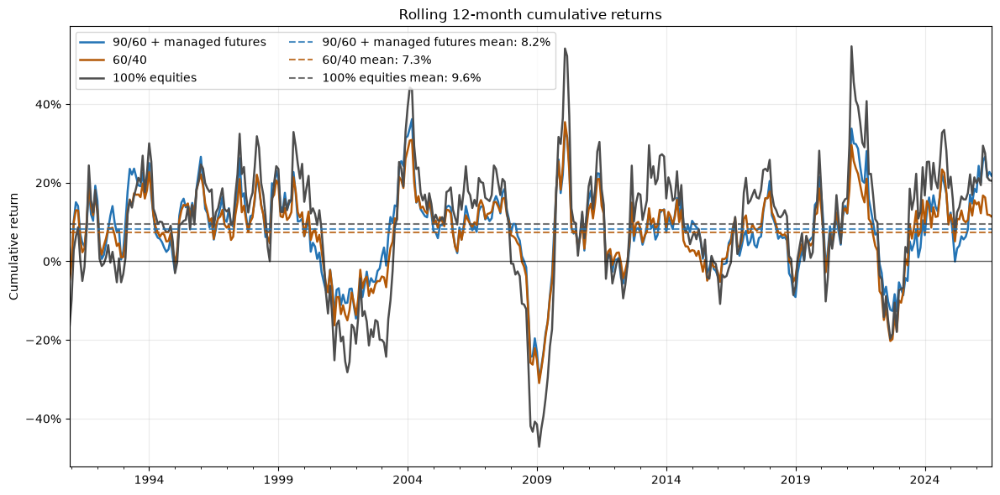
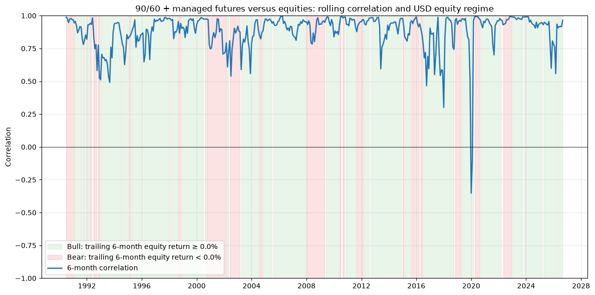
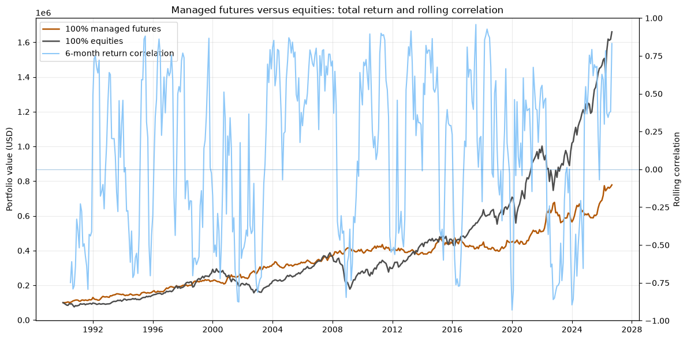

Qualche giorno fa, mentre ascoltavo uno dei miei podcast preferiti, rimasi quasi stupito dall'affermazione (provocatoria) di uno degli host: "90/60 + DBMF è ormai Pareto superior a 60/40", con il non troppo implicito sottotesto: "se hai ancora un 60/40 sei un coglione".

Pur essendo generalmente d'accordo (e avendo in portafoglio un'allocazione simile), mi è venuta la naturale curiosità di testare questa dichiarazione.

Per i fan di "VWCE & chill", breve recap:
- per 60/40 si intende generalmente un portafoglio composto al 60% da azioni (solitamente di aziende diversificate a livello globale) e al 40% da obbligazioni (qui la scelta è più complessa e dipende dal paese o dalla valuta di riferimento);
- per 90/60 si intende invece un portafoglio con un'esposizione del 90% alle azioni e del 60% alle obbligazioni, ottenuta tramite l'utilizzo di contratti futures obbligazionari. 
- _Lastly,_ DBMF è un ETF che cerca di replicare la performance dei maggiori fondi di managed futures che operano tramite trend following

Di conseguenza, la ratio dietro un portafoglio 90/60 + managed futures (da cui in avanti: il "model portfolio") è quello di combinare la capital efficiency, cioè l'uso efficiente del capitale e quindi della leva finanziaria per sfondare il muro del 100% e liberare spazio per altri diversificatori, in questo caso i managed futures, in grado di  offrire diversificazione anche quando bonds e stocks vanno in rosso.

Per il 90/60, si possono considerare i due ETF più diffusi: NTSX (90% equities US + 60% futures su Treasury USA) e NTSG (90% equities dei mercati sviluppati con un filtro ESG + 60% futures su titoli di Stato di paesi sviluppati), mentre per i managed futures, a seconda di investire in prodotti UCITS o meno, esistono diversi prodotti oltre a DBMF che offrono esposizione trend following tramite i futures.

Dettagli e approfondimenti disponibili nell'appendice tecnica in coda all'articolo e nel relativo [notebook Python](03_pareto_superiority_90_60.ipynb) su Github.

---

L'idea dietro questa breve analisi è, _again_, capire se "regge" la Pareto superiority, o, in altre parole, studiare la performance relativa del model portfolio rispetto a un classico 60/40.

Sulla carta, tutto sembra facile: prendi gli ETF menzionati, esegui un backtest di qualche decina d'anni, calcoli Sharpe e CAGR  e il gioco è fatto. Peccato che NTSG abbia due anni di storia, DBMF poco di più e la scelta per unico ETF di bond è tutt'altro che scontata e dipende fortemente  valuta di riferiento e paese di resdienza.

Per quanto riguarda il 60/40 tuttavia, la soluzione è abbastanza semplice: una combinazione lineare degli indici MSCI World net total return e FTSE WGBI Developed Markets total return (con una stima ottimistica di TER dello 0.10% per ciascuno), permette di avere una proxy per un ETF 100% azionario e un portafoglio 60/40. _(Nell'analisi, tuttavia, queste proxy sono sostituite i ritorni degli ETF "veri" per maggiore fedeltà.)_

Per NTSG la faccenda è leggermente più complicata. In primis, l'ETF investe tramite contratti futures che, per loro natura, non hanno una serie di prezzi continua nel tempo, in quanto soggetti a delivery e rolling, cioè alla sostituzione dei contratti in scadenza. Esistono delle serie storiche "aggiustate" che riconciliano il divario tra un contratto e l'altro, ma fare backtest su di esse comporta una serie di semplificazioni e l'omissione dei costi di transazione e roll.
Secondariamente, NTSG ha una metodologia tutt'altro che semplice: oltre ad applicare un filtro ESG alla sua selezione di azioni, investe in futures su titoli di Stato di Stati Uniti, Germania, Giappone e Regno Unito e ribilancia le posizioni periodicamente a febbraio, maggio, agosto e novembre o quando l'esposizione si discosta da quella target per olte 5 punti percentuali.

Di conseguenza, sono partito da un modello semplice di return stacking:

$$
R_{90/60,t}^{\mathrm{gross}}=0{,}90R_{E,t}+0{,}60R_{B,t}-0{,}50R_{cash,t}.
$$

dove R_E è il ritorno dell'indice azionario, R_B di quello obbligazionario e R_cash rappresenta il costo del finanziamento.

La versione effettivamente usata nel backtest aggiunge il TER mensile della proxy (0.85%)e un drag d = 0,50% annuo sul nozionale obbligazionario:

$$
R_{90/60,t}^{\mathrm{net}}\approx0{,}90R_{E,t}+0{,}60R_{B,t}-0{,}50R_{cash,t}-c_{TER,m}-0{,}60\frac{0{,}d}{12},
\qquad c_{TER,m}=1-(1-0{,}25\%)^{1/12}.
$$

_(Come prima, da dicembre 2024 l'analisi usa invece i rendimenti reali osservati di NTSG e non più l'ETF replicato sinteticamente)_

Quello che ne risulta, più che una replica storica di NTSG, è un generico 90/60: la proxy non modella direttamente i contratti futures, il collaterale multivaluta, la selezione ESG o i margini giornalieri. In particolare, un indice di obbligazioni estere cash unhedged incorpora il cambio sull'intero capitale investito, mentre un future non implica automaticamente la stessa esposizione valutaria sul nozionale: contano conversione di profitti e perdite, margini e collaterale. 

Per quanto riguarda DBMF, le informazioni disponibili non sono sufficienti per ricostruire fedelmente il suo processo storico e le esposizioni ai singoli contratti futures. Inoltre, Il modello preciso di replicazione è ovviamente proprietario e, pur essendo descritto nei suoi principi generali; npn è sufficiente trasparente a ricavarne una replica accurata.

Di conseguenza, ho considerato tre possibili indici proxy di DBMF (SG Trend, SG CTA e BarclayHedge BTOP50), oltre al fattore AQR TSMOM, e li ho confrontati con DBMF nei mesi comuni da giugno 2019 a maggio 2026 paragonandone la correlazione. 
Il più affine (maggiore correlazione, minore tracking error) è risultato SG CTA, scelto dungque come proxy sintetica tra il 2000 e il 2019, mentre per gli anni precedenti  sono stati considderati i ritorni di BT0P50 e per queli successivi le performnace di DBMF iun carne e ossa. come ipotesi.

Avendo dunque tutti gli ingredienti sul tavolo, restano alcuni parametri liberi da scegliere/calibrare (principalmente legati alle stime dei costi dei futures, delle fee dei prodotti e delle strategie di ribilanciamento). _Again,_ dettagli tecnici e la ratio dietro ogni scelta nell'appendice.

Il backtest in USD copre rendimenti mensili dal 1990 al 2026 e confronta il 60/40 e il 100% stocks con un model portfolio. 
Nella sua versione in EURO senza hedging valtario,, a parità di condigurazione iniziale, il fattore valutario è comune e di conseguenza le performance relative sono necessariamente preservato. Al contrario, volatilità, drawodn e rapporti dirschi rendimento restano sensibili al camio valuta.

| Portafoglio | Rendimento totale | CAGR | Volatilità | Max drawdown | Average drawdown | Ulcer index | Sharpe | Sortino | Calmar |
| --- | ---: | ---: | ---: | ---: | ---: | ---: | ---: | ---: | ---: |
| 90/60 + managed futures | 1321.61% | 7.51% | 10.35% | -32.25% | -4.91% | 7.23% | 0.49 | 0.75 | 0.23 |
| 60/40 | 950.88% | 6.63% | 9.94% | -34.24% | -4.62% | 7.90% | 0.43 | 0.62 | 0.19 |
| 100% stocks | 1560.24% | 7.96% | 15.02% | -54.09% | -6.78% | 15.31% | 0.41 | 0.58 | 0.15 |

Tirando un po' le somme.... se volessimo fare i "pignolazzi", almeno secondo questa simulazione, il model portfolio NON risulta Pareto SUperior a un classico 60/40 (si noti infatti la maggiore volatilità e l'average drawdown) ma, assumendo un buon margine d'errore e chiudendo un occhio, la tesi del podcast regge.

A fronte di 41 basis point di volatilità annualizzata in più e un drawodn medio leggermente più profondo, il model portfolio presenta nel campione un CAGR maggiore (7.51% vs 6.63%)rispetto a un classico 60/40.
Si noti che, senza troppe sorprese vista la presenza di un ulteriore diversificatore (i managed futures!), il model portfolio offre anche un profilo di rischio più conservativo rispetto al 100% stocks.
In questo caso infatti, a fronte di un CAGR tuttosommato simile (7.51% vs 7.96%), il model portfolio presenta volatilità e average drawdown nettamenti inferiori in valore assoluto (10.35% vs 15.02% e -4.91% vs -6.78%).

Facendo uno step avanti nell'analisi, emergono (almeno) altre due cose worth mentioning:
- la deviazione standard dei rendimenti cumulati rolling su 12 mesi è simile tra model portfolio e 60/40 (10.35% vs 9.97%), mentre è più alta per il 100% stocks (15.87%).

- la correlazione rolling a sei mesi tra managed futures e 100% equities diminuisce durante i bear market azionari, a dimostrazione del fatto che il diversificatore funziona soprattutto nei momenti ni cui tutto sembra andare a puttane. Al contrario, nei momenti di fortin bull marketq  (esattamente come dal covid a oggi), difficile battere le azioni in termini di rendimento atteso

Lunge da me 1) promuovere NTSG 2) denigrare VWCE & chill 3) smentire gente che ne sa molto più di me... Numeri e commenti proposti sono nascono solo da una curiosità e dalla necessità di scomporre e modellare un problea nel modo piùà accurato possibile, anche quando dati e regole del gioco sono tutt'altro che chiare.
Secondariamente, come già accennato qui, attribuisco rilevanza molto limitata ai backtest... se "past performance is not indicative of future results" è una delle frasi più abusate a Wall Steet ci sarò un motivo!

---

## Appendice

L'obiettivo iniziale dell'analisi era paragonare un'allocazione 90/60 + Managed Futures implementata tramite NTSG + DBMF su una finestra temporale estesa. Tuttavia, per mancanza di dati, l'analisi si avvicina a un confronto tra una strategia 90/60 + managed futures, costruita con return stacking, e il classico 60/40.

## A0 — Metodologia

Il backtest usa rendimenti mensili in USD da gennaio 1990 ad agosto 2026. Il 60/40 e il 100% azionario sono costruiti con le rispettive serie storiche disponibili; il model portfolio combina un'esposizione azionaria del 90%, un'esposizione obbligazionaria target del 60% e una quota di managed futures. Quando disponibili, i rendimenti osservati di NTSG e DBMF sostituiscono le rispettive proxy sintetiche.

Per estendere il campione, il 90/60 è approssimato con indici azionari e obbligazionari più un drag annuo dello 0,50% applicato al nozionale obbligazionario; DBMF è invece rappresentato da SG CTA nel periodo 2000–2019 e da BTOP50 negli anni precedenti. I portafogli sono confrontati tramite rendimento totale, CAGR, volatilità, drawdown e rapporti rischio/rendimento. Il bootstrap circolare a blocchi appaiati verifica inoltre se il vantaggio relativo osservato sia robusto a diverse lunghezze di blocco. I risultati sono quindi indicativi: descrivono una simulazione con proxy e ipotesi esplicite, non la performance storica esatta di NTSG + DBMF.

## A1 — Rischio valutario della proxy obbligazionaria

La proxy del 90/60 usa un indice di obbligazioni estere non coperto dal rischio di cambio. In pratica, se l'euro, la sterlina o lo yen si muovono contro il dollaro, il rendimento dell'indice cambia anche per effetto della valuta, oltre che per cedole e prezzi delle obbligazioni.

Un future obbligazionario non funziona allo stesso modo: espone al rendimento del titolo tramite margini e collaterale, senza richiedere l'acquisto dell'intero nozionale nella valuta estera. Perciò il 60% di un indice obbligazionario cash non equivale necessariamente al 60% di futures obbligazionari.

NTSG mantiene collaterale in USD, EUR, GBP e JPY; la proxy combina invece obbligazioni non coperte con finanziamento legato ai T-bill USA. Cambiano quindi esposizione valutaria, carry, finanziamento e collaterale. Il drag inserito nel modello rappresenta solo un costo ipotetico e **non elimina queste differenze**: volatilità, correlazioni e rendimenti della proxy possono discostarsi da quelli di NTSG.

## A2  Sensibilità delle ipotesi

Sulla configurazione gennaio 1990–agosto 2026, il CAGR resta sensnbieile alle assunzioni di drag.

| Ipotesi | CAGR model portfolio |
| --- | ---: |
| Drag obbligazionario 0% annuo sul nozionale | 7.71% |
| Drag obbligazionario 0.50% annuo sul nozionale — baseline | 7.51% |
| Drag obbligazionario 1.00% annuo sul nozionale | 7.31% |
| Gross-up CTA ipotetico 2%/20%, con drag baseline | 8.52% |

Il gross-up sposta il CAGR di circa **1.01 punti percentuali annui**, mentre dimezzare o raddoppiare i costi di trading dell'investitore lo porta rispettivamente a circa **7.52% e 7.48%**.

## A.3 Proxy NTSG

Utilizzando un drag pari a zero, il breve confronto tra NTSG e il proxy 90/60, da dicembre 2024 ad agosto 2026, il notebook produce:

- correlazione mensile **0.990**;
- tracking error annualizzato **1.75%**;

Tuttavia, il backtest  utilizza lo 0.50% annuo sul nozionale obbligazionario nei mesi sintetici per adottare un approcio più conservativo.
